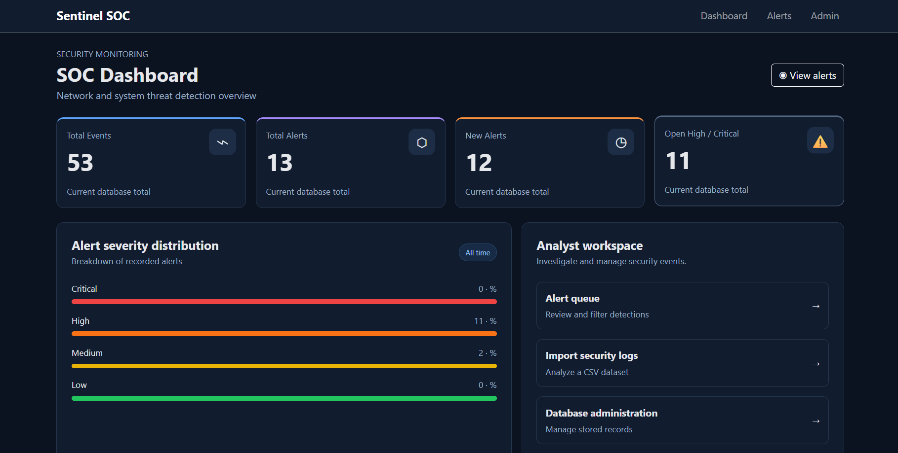
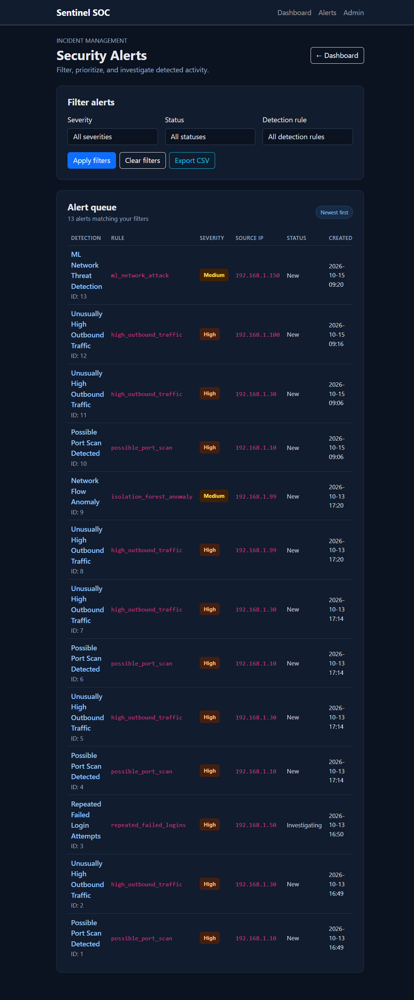

# AI Threat Detection System

A Django-based cybersecurity portfolio project that combines machine-learning classification with rule-based detection to identify suspicious network activity and authentication events.

## Project Overview

The system processes security events and network traffic data from CSV files, evaluates suspicious activity, and generates alerts to support security analyst triage.

### Key Features

- CSV-based security event ingestion
- Random Forest-based network traffic classification
- Rule-based detection for high outbound traffic
- Potential port-scan detection
- Repeated failed-login detection
- Alert severity, evidence, and source information
- Dashboard and alert filtering for analyst triage

## Application Screenshots

> Replace the example filenames below with the exact names of your screenshot files.

### Security Dashboard



### Security Alerts



### Alert Details


## Technology Stack

- **Language:** Python
- **Web framework:** Django
- **Database:** SQLite for local development
- **Data processing:** pandas
- **Machine learning:** scikit-learn
- **Model serialization:** joblib
- **Frontend:** Bootstrap
- **Dataset:** CIC-IDS2017 for model experimentation

## Detection Capabilities

| Detection | Method |
|---|---|
| Suspicious network traffic | Machine-learning classifier |
| High outbound traffic | Threshold-based rule |
| Potential port scanning | Distinct destination-port threshold |
| Repeated failed logins | Authentication-event aggregation |
| Alert triage | Severity, status, and detection-rule filters |

## Project Structure

```text
ai-threat-protection/
├── config/
│   ├── artifacts/
│   │   └── evaluation.json
│   ├── config/
│   ├── detector/
│   ├── manage.py
│   └── requirements.txt
├── data/
│   └── prepare_cic.py
├── detector/
│   └── management/
├── docs/
│   └── screenshots/
├── .gitignore
├── MODEL_EVALUATION.md
└── README.md
```

This is a simplified overview; additional experiment scripts and Django files are present in the repository. Large datasets, virtual environments, local databases, and trained model binaries should remain outside version control.

## Local Setup

### Prerequisites

- A compatible Python installation
- Git
- The project source code
- The trained model artifact if you want to use machine-learning inference

### Installation

Run these commands from the repository root in PowerShell:

```powershell
python -m venv .venv
.\.venv\Scripts\Activate.ps1
python -m pip install -r .\config\requirements.txt
python .\config\manage.py migrate
python .\config\manage.py runserver
```

Open `http://127.0.0.1:8000/` in your browser.

### Model Artifact

The trained model is not committed to Git. The expected path is:

```text
config/artifacts/network_model.joblib
```

The model must be generated using the project's training workflow or supplied separately. Without this artifact, machine-learning inference may not work.

Review the training command and dataset requirements before attempting to train a new model.

## Automated Tests

Run the detection tests:

```powershell
python .\config\manage.py test detector.tests --verbosity 2
```

The current test suite contains five tests covering:

- High outbound traffic alerts
- ML prediction evidence
- Port-scan threshold behaviour
- Repeated failed-login alerts

**Latest local verification:** Five tests passed, and Django's system check reported no issues.

## Model Evaluation

The classifier has been evaluated using prepared CIC-IDS2017 data and additional